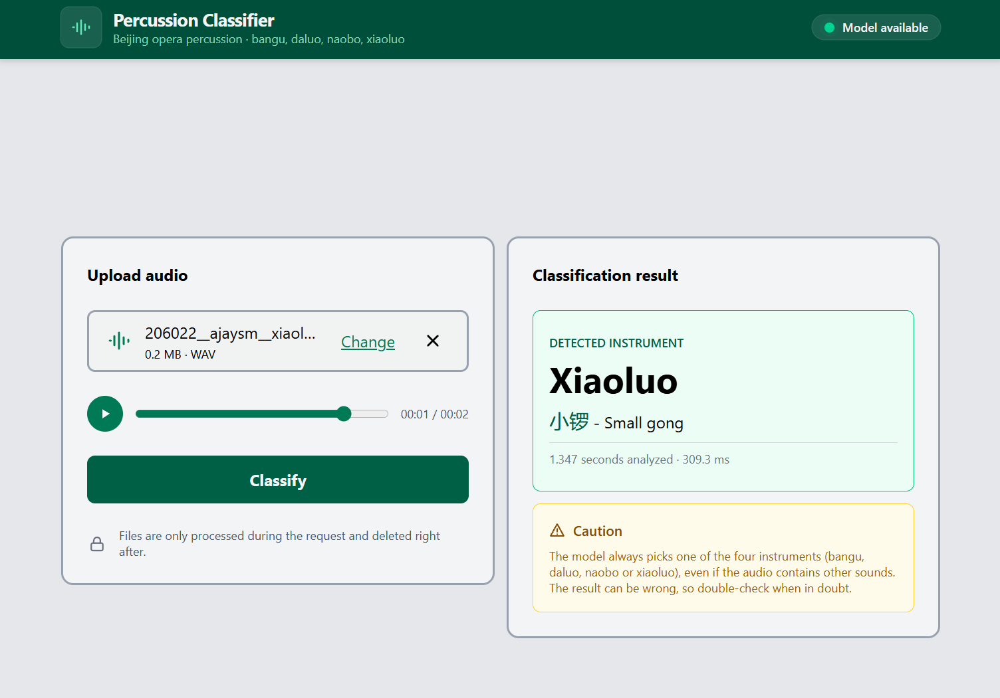

# Beijing Opera Percussion Instruments Classification

**Classifying traditional Chinese percussion sounds with classic machine learning, served through a web app.**

<p>
  
</p>

---

## About

This project uses two classic machine learning algorithms, **Support Vector Machines (SVM)** and **K-Nearest Neighbours (KNN)**, to classify Beijing Opera percussion instruments from audio recordings of single strokes.

It has three parts:

| Part                  | What it does                                                                     | Main files                                                                                                |
| --------------------- | -------------------------------------------------------------------------------- | --------------------------------------------------------------------------------------------------------- |
| **Model development** | Preprocesses the audio, extracts features, trains SVM and KNN, and compares them | `experiment.ipynb`, `preprocessing.py`, `feature_extraction.py`, `model.py`, `evaluation.py`, `config.py` |
| **Backend**           | FastAPI server that loads a trained model and classifies uploaded audio          | `backend/`                                                                                                |
| **Frontend**          | Vue web app to upload a recording, play it back and see the predicted instrument | `frontend/`                                                                                               |

## Dataset

We use the public **[Beijing Opera Percussion Instrument Dataset](https://zenodo.org/records/1285212)** from Zenodo.

It contains **236 recordings** covering **4 instrument classes**:

| Instrument               | Description                                                                                                       |
| ------------------------ | ----------------------------------------------------------------------------------------------------------------- |
| **Bangu** (Clapper-drum) | Made of the _ban_ (a wooden board-shaped clapper) and the _danpigu_ (a wooden drum struck with two wooden sticks) |
| **Naobo** (Cymbals)      | A pair of cymbal instruments: _Qibo_ and _Danao_                                                                  |
| **Daluo**                | Large gong                                                                                                        |
| **Xiaoluo**              | Small gong                                                                                                        |

For a thorough explanation of the dataset, read the authors' paper (free to access):
[Beijing Opera percussion instrument dataset, IEEE Xplore](https://ieeexplore.ieee.org/document/6853981/)

## Models

| Model   | Type                   |
| ------- | ---------------------- |
| **SVM** | Support Vector Machine |
| **KNN** | K-Nearest Neighbours   |

The notebook trains both models on several training sets: the original recordings, augmented copies (added noise, MP3 compression, down-sampling), and combinations of them. Each model is tested against every test condition. The web app uses the SVM trained on all of them (`models/all_svm.pkl`).

## Project structure

```
beijing-percussion-classification/
├── backend/                 FastAPI server
│   ├── server.py            app, CORS, model loading
│   ├── routers/             /api/health, /api/predict
│   ├── services/            preprocessing + prediction for one upload
│   ├── schemas/             request / response models
│   └── utils/               upload validation, error codes
├── frontend/                Vue 3 + Vite + Tailwind web app
├── dataset/                 the Zenodo recordings (you add this, see below)
├── models/                  trained models (.pkl), created by the notebook
├── requirements/            Python dependencies, split by part
├── config.py                shared settings (sample rate, paths, ...)
├── preprocessing.py         loading, onset alignment, clipping, splitting
├── feature_extraction.py    audio features
├── model.py                 SVM / KNN wrappers, save / load
├── evaluation.py            metrics and plots
├── experiment.ipynb         the full training and evaluation pipeline
└── requirements.txt         installs every Python dependency
```

## Getting started

### Prerequisites

- **Python 3.11** (conda or a virtual environment)
- **Node.js** `22.18+` or `24.12+` (only for the web app)

### 1. Get the project

```bash
git clone https://github.com/KrustyCode/beijing-percussion-classification.git
cd beijing-percussion-classification
```

Or download the ZIP file from GitHub and extract it.

### 2. Add the dataset

> **Note:** The dataset is **not included** in this repository.

Download it from the [Zenodo page](https://zenodo.org/records/1285212) and put the `.wav` files in a folder named `dataset` at the root of the project:

```
beijing-percussion-classification/
├── dataset/
│   ├── 205972__ajaysm__daluo-01.wav
│   ├── 205973__ajaysm__bangu-06.wav
│   └── ...
├── experiment.ipynb
└── ...
```

The class of each clip is read from its file name, so keep the original names.

### 3. Create a Python environment

With conda:

```bash
conda create -n percussion python=3.11
conda activate percussion
```

Or with `venv`:

```bash
python -m venv .venv
.venv\Scripts\activate        # Windows
source .venv/bin/activate     # macOS / Linux
```

### 4. Install the Python dependencies

```bash
pip install -r requirements.txt
```

This installs everything. To install only one part, use a file in `requirements/`:

| File                       | Installs                                                    |
| -------------------------- | ----------------------------------------------------------- |
| `requirements/base.txt`    | Shared core (numpy, librosa, soundfile, scikit-learn, tqdm) |
| `requirements/dev.txt`     | Core + notebook, EDA and evaluation tools                   |
| `requirements/backend.txt` | Core + FastAPI server                                       |

### 5. Train the models

1. Open `experiment.ipynb`
2. Select the Python environment from step 3 as the kernel
3. Run all cells

This saves the trained models to `models/` and the results to `pipeline_output/`. The web app needs `models/all_svm.pkl`, so **run the notebook before starting the backend**.

## Running the web app

Run the backend and the frontend in two terminals.

### Backend

From the project root, with the Python environment active:

```bash
uvicorn backend.server:app --reload
```

The API runs at <http://localhost:8000>, with interactive docs at <http://localhost:8000/docs>.

| Endpoint            | Description                                     |
| ------------------- | ----------------------------------------------- |
| `GET /api/health`   | Whether the model is loaded                     |
| `POST /api/predict` | Classify one uploaded `file` (`.wav` or `.mp3`) |

Uploads must be at most **10 MB** and between **0.05 and 10 seconds** long.

### Frontend

```bash
cd frontend
npm install
npm run dev
```

Open <http://localhost:5173>. The green dot in the header shows that the frontend can reach the backend and the model is loaded.

> **Different port or host?** The backend only accepts requests from `http://localhost:5173` and `http://127.0.0.1:5173`. If Vite starts on another port, add that origin to `CORS_ORIGINS` in `backend/server.py`. To point the frontend at a backend that is not on `http://localhost:8000`, create `frontend/.env` with `VITE_API_URL=http://your-host:port`.

### Using the app

1. Drag a `.wav` or `.mp3` recording of **one instrument stroke** into the upload panel, or click **choose a file**
2. Optionally play it back to check it
3. Click **Classify**

The model always picks one of the four instruments, even if the recording contains something else, so treat the result as a prediction, not a guarantee.

## References

- Tian, M., Srinivasamurthy, A., Sandler, M., Serra, X. _A study of instrument-wise onset detection in Beijing opera percussion ensembles._ ICASSP 2014. [IEEE Xplore](https://ieeexplore.ieee.org/document/6853981/)
- [Beijing Opera Percussion Instrument Dataset, Zenodo](https://zenodo.org/records/1285212)
